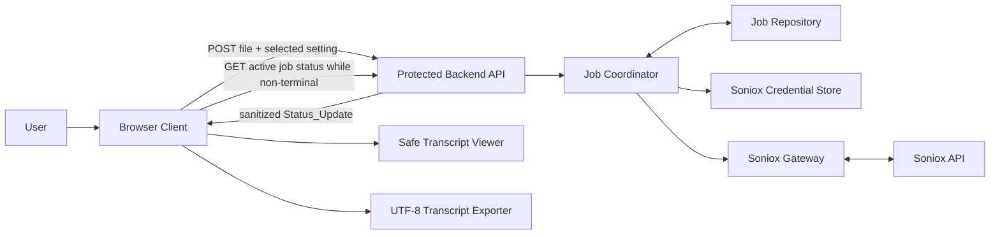
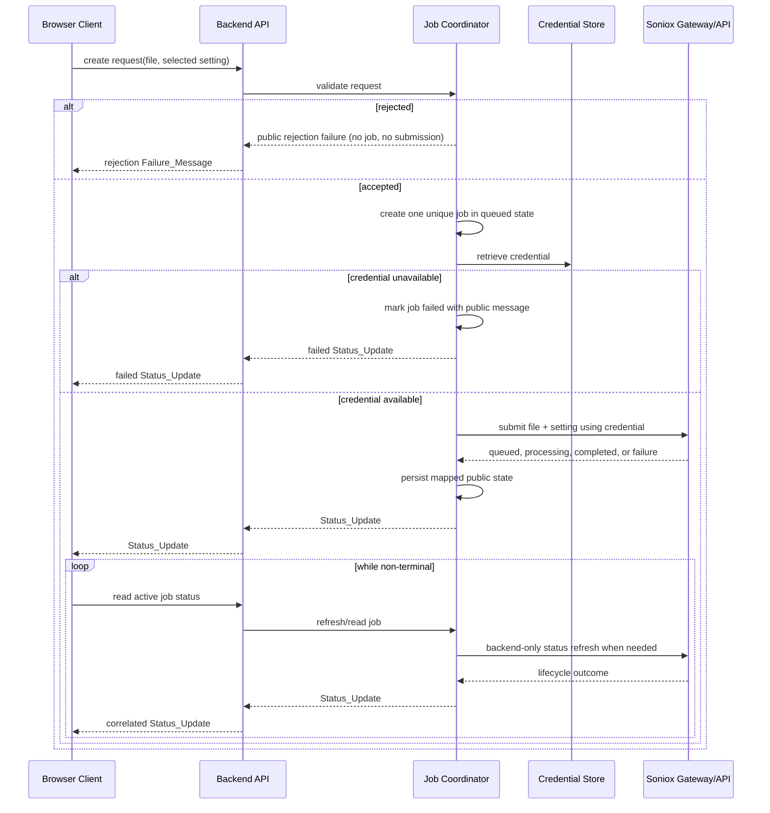

# Technical Design: Soniox Audio Transcription

**Feature:** `soniox-audio-transcription`  
**Workflow:** Requirements-first feature  
**Status:** Ready for review  
**Requirements source:** [requirements.md](requirements.md)

## Overview

Soniox Audio Transcription is a focused browser application that accepts exactly one browser-recognized audio file, sends it to a same-origin backend for transcription, keeps provider credentials server-side, communicates the job lifecycle, safely presents the completed transcript, and exports that exact transcript as a UTF-8 `.txt` download.

The implementation is deliberately split into a Browser Client, a protected Backend API, and a provider adapter. The browser never knows the Soniox credential or calls the Soniox API. The backend owns request validation, opaque job creation, provider submission and refresh, credential lookup, public-status sanitization, and failure conversion. The UI is a small state-driven workflow rather than a general dashboard, allowing the required idle, queued, processing, failed, and completed layouts to remain mutually exclusive.

### Design context and findings

This design was derived only from the approved local [requirements.md](requirements.md) and the supplied Precision Core design reference; no external API research is used. The requirements deliberately define the Soniox integration in terms of submitting an audio file and settings, then receiving queued, processing, completed, or failed updates. Therefore, the design uses a provider-neutral `SonioxGateway` boundary and does not prescribe unsupported provider paths, payload fields, model names, or callback behavior.

Key design consequences are:

- An accepted file is defined exclusively by exactly one selected file, a browser-provided type beginning with `audio/`, and an unmodified 1–255-character filename. No undocumented codec, extension, or size restriction is added.
- The backend creates one job for each non-rejected request before credential retrieval and provider submission, so credential and provider failures can be associated with that job.
- The client must tolerate duplicate, late, and mismatched status updates: a terminal state is immutable, and an update for any other job cannot change the displayed job.
- Transcript handling is a lossless text path: transcript content is rendered as text, not markup, and the exporter serializes the same string as UTF-8.
- The supplied Precision Core system is applied through Tailwind CSS tokens and utilities for all browser-visible styling.

### Scope and intentional constraints

- The language selector exposes automatic detection by default and submits the exact selected setting. The requirements do not define a language catalogue, so its allowed non-automatic values remain a configuration decision for implementation.
- The backend may use a process-local job repository for a single-instance simple deployment, provided it satisfies the required job lifecycle. A durable repository can replace it without changing the browser contract.
- Browser jobs are polled from the same-origin backend. Polling the provider, provider result retrieval, and credential handling are backend-only concerns.
- Browser download APIs cannot universally detect every operating-system-level save failure. The client must surface a failure only when its download operation reports one, while preserving the displayed transcript.

## Architecture

### System context

The Browser Client communicates only with the Backend API at the application origin. `SonioxGateway` and `SonioxCredentialStore` are backend-private dependencies: they have no browser route, serializable client representation, or log output exposed to the user.

### Job lifecycle

```mermaid
stateDiagram-v2
    [*] --> Idle
    Idle --> Ready: valid one-file selection
    Ready --> Idle: invalid selection or start-new reset
    Ready --> Queued: POST accepted; job created
    Queued --> Processing: processing Status_Update
    Queued --> Completed: completed Status_Update
    Queued --> Failed: credential, submit, or provider failure
    Processing --> Completed: completed Status_Update
    Processing --> Failed: provider failure
    Completed --> Ready: select/start a new job
    Failed --> Ready: select/start a new job

    note right of Queued
      settings disabled; one status poll at a time
    end note
    note right of Completed
      terminal state; settings enabled
    end note
    note right of Failed
      terminal state; retry/start-new action visible
    end note
```

The `Ready` state is visually part of the required idle-upload layout: it adds the selected filename and enables the transcription action without introducing a sixth layout category. Once a status update records `completed` or `failed` for the active job, that terminal state wins over every later update for the same job.

### Status delivery and polling

1. The Browser Client validates selection locally and enables submission only for an `Accepted_Audio_File`.
2. On submission, the client sends one request containing the selected file and selected language preference, creates the active-job display from the returned initial status, disables settings, and starts polling.
3. While the active job is `queued` or `processing`, the client makes no more than one status request at a time and polls the Backend API every 1 second. It cancels outstanding work and discards responses if a new job becomes active or the component is removed.
4. For a status request, the Job Coordinator reads the current backend job. It refreshes the job through `SonioxGateway` when required by the adapter, maps the provider outcome to a sanitized public `Status_Update`, stores the new backend state, and returns the latest update.
5. The client immediately reduces a received, correlated update into UI state. This keeps the required visible status change within 1 second of receipt. It stops polling when the job is terminal.

This approach avoids browser-to-provider traffic and works whether the eventual provider adapter performs immediate submission, server-side result polling, or another supported backend-only lifecycle. A later push transport can feed the same `Status_Update` reducer without changing the public job models.

## Components and Interfaces

### Browser Client

| Component | Responsibilities | Requirement coverage |
|---|---|---|
| `TranscriptionPage` | Owns the active-job state machine, starts/cancels polling, and selects exactly one layout for the current state. | 4, 5.4, 7.2 |
| `FileSelectionController` | Handles file input and drop events; calls the shared selection validator; clears invalid state; exposes the required idle copy and browse action. | 1 |
| `LanguagePreferenceControl` | Initializes to automatic detection, submits the exact selected value, and locks for non-terminal active jobs. | 3 |
| `JobStatusRegion` | Renders Queued, Processing plus a distinct non-text indicator, Completed, or Failed; announces changes accessibly. | 4 |
| `TranscriptViewer` | Displays only a completed active job's transcript as literal text and preserves whitespace and line breaks. | 5 |
| `TranscriptExporter` | Builds exactly one text download for a completed transcript and reports a download-operation failure without clearing the viewer. | 6 |
| `ClientStatusReducer` | Correlates updates by job ID, prevents terminal rollback, validates failure-detail display, and ignores non-active updates. | 3.3, 4.3, 4.5–4.8 |

All visual styles are Tailwind CSS utilities or Tailwind theme tokens. The application must not introduce a separate CSS styling system for browser-visible elements.

### Backend API

The API is same-origin and accepts only browser-client requests. It does not expose credential retrieval, provider control, provider handles, raw exception objects, or internal logs.

| Operation | Input | Success response | Failure behavior |
|---|---|---|---|
| Create transcription | One multipart request containing one audio file and one selected language-preference value. | `202 Accepted` with the initial public `Status_Update` for the newly created job. A rapid provider completion or failure may be represented by its corresponding status. | A rejected input returns one public 1–500-character rejection `Failure_Message`; no job is created and no provider submission occurs. |
| Read transcription status | Opaque job identifier from the active client job. | Latest public `Status_Update` for that job. | Returns a public failure response only; no provider credential, provider payload, or internal error is revealed. |

The exact URL names and wire-library choices are implementation details. A practical implementation may use `/api/transcriptions` and `/api/transcriptions/{jobId}/status`, but the browser contract is defined by the operations and public models below rather than by a provider protocol.

### Backend services

| Service | Responsibilities and boundaries |
|---|---|
| `RequestValidator` | Reapplies the same accepted-file rule on the backend: exactly one file, browser-provided `audio/` media type prefix, and supplied filename length 1–255. It rejects before job creation if the request is invalid. |
| `JobCoordinator` | Creates exactly one non-rejected job with a unique opaque identifier; coordinates credential retrieval, provider submission, refresh, status persistence, and public failure mapping. |
| `JobRepository` | Stores job ID, public lifecycle state, selected setting, provider correlation handle, timestamps, completion transcript, and sanitized failure message. It never stores a credential or raw internal error detail. |
| `SonioxCredentialStore` | Backend-only configuration or secret-storage adapter. It returns the credential solely to `JobCoordinator`/`SonioxGateway` during provider work. |
| `SonioxGateway` | Backend-only adapter that submits an accepted file and settings and obtains lifecycle outcomes from the Soniox API. It converts provider-specific structures into the four requirement-defined states without leaking them to the client. |
| `PublicStatusMapper` | Enforces public response shape, bounds backend-generated failure messages to 1–500 characters, and removes credentials, stack traces, request diagnostics, and provider-internal fields. |

### Provider interaction sequence

## Data Models

### Input and server records

| Model | Fields and invariants |
|---|---|
| `FileSelection` | Zero or more browser files from one browse event or one drop event. It is accepted only when it contains exactly one valid file. |
| `AcceptedAudioFile` | The original browser file bytes/stream, supplied filename, and browser-provided media type. Valid iff media type begins with `audio/` and filename length is 1–255 characters. The filename is preserved without modification for display. |
| `TranscriptionSettings` | A selected source-language preference. Its initial client value is automatic language detection. The precise non-automatic option catalogue is configuration-owned; the client forwards the selected value unchanged. |
| `TranscriptionJob` | Internal record: `jobId`, `state`, `settings`, provider correlation handle, created/updated timestamps, optional `transcriptText`, and optional sanitized `failureMessage`. `jobId` is created from a cryptographically strong opaque unique identifier. The record excludes credentials and raw internal errors. |
| `ProviderOutcome` | Backend-private adapter result: queued, processing, completed with transcript text, or failed with provider context. It is never sent directly to the browser. |
| `StatusUpdate` | Public object with `jobId` and one state: `queued`, `processing`, `completed`, or `failed`. A completed update includes `transcriptText`; a failed update includes a client-safe `failureMessage`. |
| `FailureMessage` | A user-readable, non-empty public message. Backend-created values have 1–500 characters. The client accepts a received failed-message value only when it has 1–1,024 characters; otherwise it substitutes “Failure details are unavailable.” |

The backend streams or retains source audio only for the duration necessary to complete provider submission. There is no requirement to persist source audio after handoff, and no source audio, credential, or raw provider diagnostic appears in public job data.

### Client state model

| State field | Rule |
|---|---|
| `selectedFile` | Holds the sole valid selection or `null`. Every invalid browse/drop event sets it to `null`. |
| `selectedSettings` | Starts as automatic detection. It can change only when no active job exists or the active job is terminal. |
| `activeJobId` | Set only by a non-rejected create response. A new job replaces the prior active job. |
| `displayedStatus` | Derived only from an update whose ID equals `activeJobId`. A recorded terminal value cannot be replaced by a later update for that job. |
| `displayedTranscript` | Equals the active job transcript only when its state is completed; otherwise it is the empty string. A new active job clears it before any new completion arrives. |
| `displayedFailure` | For a valid failed update, the complete received message; otherwise the standard failure-details-unavailable message. |
| `polling` | Active only for the current queued/processing job; one request at a time. It is stopped for terminal jobs and invalidated when a new job is created. |

### Public-status invariants

- A `completed` update carries the exact transcript string returned by the gateway. It never includes a failure message.
- A `failed` update carries only a sanitized, non-empty public failure message. It never includes transcript text.
- Once a job is completed or failed, no later queued, processing, completed, or failed update can replace its recorded terminal state.
- A status update for any ID other than the active job ID does not change the displayed state, transcript, failure, or settings lock.

## Precision Core UI and Accessibility Design

The UI follows the supplied Precision Core reference: systematic minimalism, high information clarity, and tonal separation rather than decorative effects. It uses the supplied token values as the visual authority: `#f8f9ff` page surface, `#ffffff` card surface, `#0b1c30` primary text, `#45464d` supporting text, `#c6c6cd` boundaries, `#0058be` interactive/status blue, and `#000000` final-action fill. Geist is used for headings, labels, timestamps, and buttons; Inter is used for instructions, failure detail, and transcript text.

### Layout and state regions

- **App shell:** A fluid 12-column desktop grid within the 1,280px maximum container, with 24px gutters. The focused upload/status/transcript workflow occupies a central column capped at 768px. The page background is `#f8f9ff` with generous 32px/64px vertical rhythm.
- **Idle/ready upload region:** A Level 1 card with a dashed 2px `#c6c6cd` upload zone, `#eff4ff` hover/drag-over wash, an enabled browse control, and the exact idle copy: “Browse for or drag one audio file into this upload zone.” A valid selection shows the untouched supplied filename and enables the trigger action. Invalid selection clears the filename and shows the exact-one-audio-file validation message.
- **Settings region:** The language label is Geist 12px semibold with tracking; the select/input is above the action row. It is disabled in queued and processing states, then re-enabled immediately on rendering the terminal state and no later than one second after terminal receipt.
- **Queued/processing region:** A restrained status card uses a labeled blue-tonal area. Processing has both the visible “Processing” text and a non-text indeterminate indicator; a subtle CSS/Tailwind-safe pulse is limited to the processing marker.
- **Failed region:** A visible “Failed” label, complete valid public failure text, and an enabled “Start new transcription” action. This action enters the upload workflow without retaining the old transcript as active content.
- **Completed region:** A visible “Completed” label, a bordered transcript viewer, and a final dark export button. The viewer uses a monospace timestamp-free text treatment only where appropriate; transcript body itself uses Inter for legibility.

### Tailwind token application

Tailwind configuration defines the Precision Core palette, Geist and Inter font families, 4px/8px/12px radii, and the 8px spacing rhythm. Visual behavior is then expressed with Tailwind utilities:

- Level 1 cards use a 1px outline/border and no shadow; active or processing regions use the light blue tonal layer.
- Menus and modal-equivalent surfaces, if introduced, use only the diffused `#0f172a` 8%-opacity, 10px-y, 20px-blur shadow prescribed by the design system.
- Upload and start actions use the secondary interactive blue with white text; final save/export uses primary black with white text. Controls have an 8px radius; main containers use 12px.
- Status chips are compact Geist labels. Processing is slate/blue with a subtle pulse; completed status uses a restrained mint/emerald tint with dark green text while preserving readable contrast.

### Responsive and accessible behavior

- From **320–767 CSS px**, the upload, settings, status, and viewer regions are one vertical column with 16px gutters. Cards and controls use `min-width: 0`, maximum-width constraints, text wrapping, and full-width controls where needed so the document scroll width never exceeds the viewport.
- From **768–3840 CSS px**, the grid may expand around the fixed-width focus column but maintains `max-width: 100%`, wrapping, and overflow-safe content so no horizontal document overflow occurs.
- Every interactive control is a semantic button, input, select, or link with an accessible name. The browse control is associated with its hidden native file input; drag/drop is an enhancement, never the sole upload path.
- Status changes use a concise polite live region. Failure text is associated with the failed status and retry action. Processing exposes text as well as its visual indicator.
- Keyboard focus uses a continuous solid 2px `#0058be` outline offset by 2px. Against the adjacent light surfaces, this meets or exceeds the required 3:1 contrast ratio. Focus is never removed or replaced solely by a box shadow.
- The transcript is rendered in a semantic text container with `white-space: pre-wrap` (or equivalent Tailwind utility), allowing all line breaks to remain visible while long unbroken strings wrap instead of creating horizontal page overflow.

## Correctness Properties

*A property is a characteristic or behavior that should hold true across all valid executions of a system-essentially, a formal statement about what the system should do. Properties serve as the bridge between human-readable specifications and machine-verifiable correctness guarantees.*

### Property 1: Audio-file selection validation is deterministic

For every generated `FileSelection` S, the Browser Client accepts S if and only if S contains exactly one file F whose media type begins with `audio/` and whose supplied filename contains 1–255 characters. When accepted, the client stores F as the sole selected file, displays F’s supplied filename unchanged, and enables submission; otherwise it clears selection, disables submission, and exposes the exact-one-audio-file validation outcome.

**Validates: Requirements 1.1, 1.2, 1.3**

### Property 2: Requests preserve settings, job identifiers are unique, and credentials remain server-side

For every accepted audio file A, selected setting S, arbitrary credential C, and finite sequence of non-rejected submissions executed with local gateway and credential-store fakes, the Browser Client makes exactly one backend request containing A and S and no direct provider request. The Backend Service obtains C only from the credential-store fake, submits A and S through the gateway using C, assigns pairwise-unique job identifiers, and exposes no C or server-internal error detail in client-visible requests, responses, state, or rendered output.

**Validates: Requirements 2.1, 2.2, 2.3, 2.7, 2.8, 2.12, 3.2**

### Property 3: Terminal status and active-job display are stable

For every job identifier J, terminal status T, later sequence of status updates for J, active job identifier K, and status update whose ID differs from K, reducing the sequence after T has been recorded retains T for J, and the mismatched update changes none of the displayed status, transcript, or failure fields for K.

**Validates: Requirements 4.5, 4.8**

### Property 4: Transcript rendering preserves text without executing markup

For every Unicode transcript string T, including markup-like text and every supported line-break sequence, rendering T for a completed active job produces visible text exactly equal to T, preserves each line break, and creates no executable element, event handler, or script content from characters in T.

**Validates: Requirements 5.1, 5.2**

### Property 5: Text download is a lossless UTF-8 transformation

For every Unicode transcript string T, initiating download for a completed job generates exactly one file whose filename ends in `.txt` and whose UTF-8-decoded content equals T, including every character and line break.

**Validates: Requirements 6.1, 6.2**

### Property 6: Active job replacement clears stale transcript data

For every prior transcript value T and new job identifier J, starting J makes J the active job, replaces the displayed status with J’s current status, and leaves the transcript viewer with zero characters from T until a completed update for J supplies a new transcript.

**Validates: Requirements 5.3, 5.4**

### Property 7: Backend lifecycle outcomes are exact and client-safe

For every accepted job and provider outcome of queued, processing, completed with transcript T, or failed, the Backend Service returns one correlated public status with the same non-terminal state or the exact completed transcript, and a failed status contains a 1–500-character sanitized public message. For every rejected request, missing credential, or provider-submission failure, the service produces the required failed/rejected public outcome, never produces false completion, and makes no prohibited job creation or provider submission side effect.

**Validates: Requirements 2.4, 2.5, 2.6, 2.9, 2.10, 2.11**

### Property 8: Active-state controls and failure details normalize safely

For every active-job state, valid failed message M of 1–1,024 characters, and invalid failed detail D that is absent, empty, or longer than 1,024 characters, the settings control is disabled exactly for queued and processing active jobs; a valid failed update exposes M unchanged; and an invalid failed update exposes the failed label together with the standard failure-details-unavailable message.

**Validates: Requirements 3.3, 4.3, 4.6**

The properties above were consolidated after prework: file validation, request/credential behavior, terminal/mismatched updates, transcript safety, UTF-8 export, active-job replacement, backend outcome mapping, and failure/control normalization each test a distinct invariant. No property duplicates another property’s state transition or serialization boundary.

## Error Handling

| Condition | Backend behavior | Browser behavior |
|---|---|---|
| Zero, multiple, non-audio, empty-name, or overlong-name file selection | The create operation revalidates and rejects invalid uploads before creating a job. | Clears selected file, disables transcription action, and displays that exactly one audio file is required. |
| Rejected transcription request | Returns a 1–500-character public rejection `Failure_Message`; creates no job, persists no submitted job, and never calls the gateway. | Remains/re-enters the upload workflow and presents the public rejection message without exposing internal detail. |
| Credential unavailable after job creation | Marks that job failed and returns a correlated failed `Status_Update` with a 1–500-character public submission-unavailable message. | Shows Failed, complete valid public message, enables start-new action, stops polling, and unlocks settings within one second. |
| Provider submission error | Marks the created job failed and returns a correlated failed `Status_Update` with a 1–500-character public submission-failed message. | Same failed-state handling; no credential, stack trace, or raw provider error is shown. |
| Provider reports failure | Maps the job to failed and returns one correlated failed update. Provider diagnostics are reduced to safe user-facing language. | Shows the complete received detail only when its length is 1–1,024; otherwise shows “Failure details are unavailable.” |
| Late/duplicate update after terminal state | Retains the stored terminal state and returns/records no terminal rollback. | Ignores any transition that would replace the terminal display; polling is already stopped. |
| Update for another job | May retain it in backend job state but does not use it to mutate the active job’s public display. | Ignores it completely for active status, transcript, failure, and settings lock. |
| Malformed/unsafe transcript text | Treats transcript as opaque Unicode text, never HTML. | Renders with a text node and preserved whitespace; never uses HTML insertion, evaluation, or event attributes. |
| Browser download operation reports failure | Does not alter the completed job or transcript. | Displays a public download failure message and preserves the unchanged transcript in the viewer. |
| Unexpected backend exception | Logs only redacted operational context server-side and converts the response to a bounded generic public failure. | Shows a retryable public failure; never displays credentials, server internals, or raw exception text. |

## Testing Strategy

### Test layers

| Layer | Focus | Examples |
|---|---|---|
| Unit tests | Concrete client reducer, validator, exporter, mapper, and component scenarios. | Initial automatic setting; exact idle copy; browse control permits one file; queued/processing/completed labels; processing indicator; terminal unlock within one second using fake timers; failed retry; download-operation rejection. |
| Property-based tests | Pure and fake-backed invariants listed in Correctness Properties. | File selection boundaries; Unicode transcript rendering/export; unique IDs across submission sequences; secret/error sanitization; status-order reduction. |
| Backend integration tests with local fakes | Interaction between Job Coordinator, repository, fake credential store, and fake Soniox gateway. | Credential outage, provider submission rejection, queued-to-processing-to-completed lifecycle, no provider call on rejected upload, and provider call receives the selected setting. |
| Browser integration and visual regression | Tailwind-built layout, native input behavior, responsive rendering, accessibility, and download path. | 320px, 767px, 768px, and 3840px viewports; each required lifecycle layout; no horizontal overflow; computed focus outline; keyboard-only browse/settings/export flow. |
| Smoke/build checks | Required styling and integration boundaries. | Tailwind production build succeeds; the visible application bundle uses the Tailwind theme; no client module imports the credential store or gateway implementation. |

### Property-based testing plan

The planned TypeScript implementation uses **fast-check** for property tests. Each of the eight properties in this document is implemented by exactly one property test with at least **100 runs**. Tests must use in-memory repositories plus local fakes/mocks for `SonioxGateway` and `SonioxCredentialStore`; they must never send test files, credentials, or transcript data to Soniox or any external endpoint.

Each property test includes a design-traceability comment in this form, using the property’s full statement after the colon:

`Feature: soniox-audio-transcription, Property N: <documented universal property statement>`

High-value generators include:

- File collections with zero, one, and many entries; `audio/` and non-audio media types; filename lengths 0, 1, 255, and 256; and Unicode filenames.
- Arbitrary allowed settings, opaque job IDs, finite submission/update sequences, credential strings, and internal error strings.
- Unicode transcript text, line breaks, empty text where permitted, long text, markup-like sequences, and strings containing special characters.
- Valid client failure strings of 1–1,024 characters and invalid absent, empty, or overlong strings.

### Security and accessibility verification

- Component and browser tests must assert that transcript strings such as markup, script-looking text, and event-attribute-looking text remain text nodes and do not create executable DOM content.
- Fake credentials and internal exception strings are injected into backend tests and searched for in every public response and rendered client state to prove redaction.
- Automated accessibility checks complement manual keyboard tests. Browser tests verify semantic control names, live status announcements, disabled settings during non-terminal states, the required focus outline width and offset, and at least 3:1 adjacent-surface contrast.
- Responsive checks inspect document scroll width at the four specified viewport boundaries and capture state-specific visual baselines for idle/ready, queued, processing, failed, and completed presentations.

## Review Notes

This design intentionally leaves provider-specific request paths, response envelopes, language option catalogues, and deployment persistence choices behind backend interfaces because the requirements do not define them. If any of those details need to become user-visible or acceptance-tested behavior, return to requirements clarification before implementation so the new contract can be specified without weakening credential isolation or transcript fidelity.
