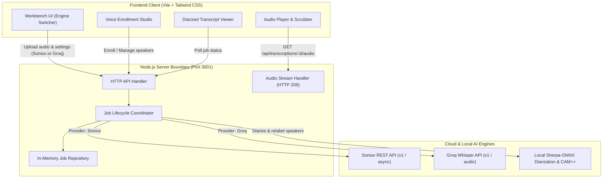

# Audio Transcriber

A high-fidelity speech recognition and voice biometric studio combining dual cloud STT engines (**Soniox Asynchronous STT** and **Groq Whisper `whisper-large-v3-turbo`**) with privacy-first **offline speaker diarization & CAM++ identification** powered by Sherpa-ONNX.

Designed with a modern workbench layout (*Technical Precision* design system), responsive pipeline telemetry, interactive timeline audio playback, and word-level timestamp toggling.

---

## ✨ Features

### 🎙️ Dual Speech-to-Text Engines
* **Soniox Asynchronous Neural STT**:
  * Large audio uploads up to 2GB across WAV, MP3, M4A, and FLAC.
  * Multi-language hints (`en`, `tl`, `es`, etc.) and automatic detection.
  * Custom domain terms and topic framing context.
  * Word-level confidence scores (< 80% uncertainty review highlights) and millisecond timestamps.
* **Groq Whisper (`whisper-large-v3-turbo`)**:
  * Ultra-fast LPUs delivering near-instant transcription.
  * Direct word-level and segment-level timestamp granularities (`startMs`, `endMs`).
  * Seamless support for vocabulary hints and context prompts.
  * File uploads up to 25MB.

### 👥 Offline Speaker Biometrics & Diarization (Sherpa-ONNX)
* **Privacy-First Neural Embeddings**: Runs 100% locally via Sherpa-ONNX with a 192-dimensional CAM++ neural network (`campplus.onnx`) and lightweight ONNX segmentation (`sherpa-onnx-pyannote-segmentation-3-0/model.onnx`). No PyTorch, HuggingFace, or biometric embeddings ever leave your machine.
* **Groq Offline Speaker Diarization**:
  * Groq Whisper does not natively provide speaker diarization. We bridge this with Sherpa-ONNX's `OfflineSpeakerDiarization`.
  * The audio speech turns are segmented locally, word tokens from Groq are aligned by temporal midpoint, and speaker turns are identified.
* **Automatic Voice Profile Matching**:
  * Diarized speaker clusters (`Speaker 1`, `Speaker 2`) are matched against enrolled voice profiles using cosine similarity.
  * Relabels speech turns directly with verified names (e.g., `Alice`, `Bob`).
* **Voice Enrollment Studio**:
  * **File Upload**: Enroll voice samples from WAV, MP3, M4A, FLAC, or OGG audio files with automatic normalization.
  * **Live Microphone Recording**: In-browser microphone capture with input device selection, live waveform meter, recording timer, and suggested enrollment scripts (10–15 seconds recommended).

### ⏱️ Timestamp Resolution & Interactive Toggling
* **Millisecond-Level Accuracy**: Soniox delivers precise word-level `start_ms` and `end_ms` token timestamps.
* **One-Click Timestamp Toggle**: The transcript header features a `⏱ Timestamps` toggle to instantly switch between:
  * **Standard View**: Clean speaker-attributed paragraphs.
  * **Timestamped View**: Precise `[MM:SS - MM:SS]` intervals per utterance.
* **Synced Export**: Both `📋 Copy` and `Download transcript` buttons respect the active timestamp view.

### 🎧 Audio Playback & Streaming Bar
* **HTTP 206 Byte-Range Streaming**: Backend endpoint `GET /api/transcriptions/:jobId/audio` enables seeking, buffering, and playback.
* **Client-Side Blob Fallback**: Plays immediately from browser memory with backend stream fallback.
* **Playback Controls**: Play/pause, clickable scrubbing track, playback speed chips (`1.0x`, `1.25x`, `1.5x`), duration counter, and file badge.
* **Diagnostic Alerts**: Built-in codec detection and graceful error messaging for unsupported browser containers (such as proprietary M4A/ALAC encodings).

### ⚡ Pipeline Telemetry & Live Equalizer
* **Queued & Processing Pipeline Steppers**: Track execution through 4 stages: *Validation* → *CAM++ Diarization* → *Acoustic ASR* → *Profile Relabeling*.
* **Live Visualizer**: 24-bar animated CSS audio spectrum equalizer and glowing shimmer progress bar.

---

## 🏗️ Architecture



### Security & Isolation Boundary
* **Server-Only Credentials**: Both `SONIOX_API_KEY` and `GROQ_API_KEY` are strictly managed backend-side and never exposed to the browser client.
* **Data Sanitization**: Client status objects redact internal provider handles, error details, and sensitive diagnostics.
* **DOM Security**: The transcript viewer uses safe text-node rendering (`createTextNode`) without `innerHTML` or markup execution risks.

---

## 🚀 Getting Started

### Prerequisites
* **Node.js**: `v20.0.0` or higher
* **Python**: `3.10` or higher
* **ffmpeg** (optional, recommended for converting non-WAV formats like M4A during local enrollment)

### 1. Installation

Clone the repository and install Node.js dependencies:
```bash
git clone https://github.com/zhy-idk/audio-transcriber.git
cd audio-transcriber
npm install
```

Install Python dependencies for Sherpa-ONNX speaker diarization and CAM++ identification:
```bash
pip install sherpa-onnx numpy soundfile pydub
```

### 2. Download Sherpa-ONNX Models

Download the pre-trained CAM++ embedding model and Pyannote segmentation model into the `models/` directory:

```bash
# Windows PowerShell
Invoke-WebRequest -Uri "https://github.com/k2-fsa/sherpa-onnx/releases/download/speaker-re-id-models/campplus.onnx" -OutFile "models/campplus.onnx"

# Pyannote segmentation model (for Groq offline diarization)
Invoke-WebRequest -Uri "https://github.com/k2-fsa/sherpa-onnx/releases/download/speaker-segmentation-models/sherpa-onnx-pyannote-segmentation-3-0.tar.bz2" -OutFile "models/segmentation.tar.bz2"
tar -xjf models/segmentation.tar.bz2 -C models/
Remove-Item models/segmentation.tar.bz2

# Linux / macOS
curl -L -o models/campplus.onnx https://github.com/k2-fsa/sherpa-onnx/releases/download/speaker-re-id-models/campplus.onnx
curl -L -o models/segmentation.tar.bz2 https://github.com/k2-fsa/sherpa-onnx/releases/download/speaker-segmentation-models/sherpa-onnx-pyannote-segmentation-3-0.tar.bz2
tar -xjf models/segmentation.tar.bz2 -C models/
rm models/segmentation.tar.bz2
```

### 3. Environment Configuration

Copy the example environment configuration:
```bash
cp .env.example .env
```

Edit `.env` with your API keys:
```env
# Speech-to-Text Providers
SONIOX_API_KEY=your_soniox_api_key_here
GROQ_API_KEY=your_groq_api_key_here

PORT=3001
PYTHON_PATH=python
```

---

## 💻 Running the Application

### Option A: Complete Development Environment (Recommended)
On Windows PowerShell:
```powershell
npm run dev:all
```
This script validates your Python setup, checks the ONNX models, and starts both the backend API server (`http://127.0.0.1:3001`) and Vite frontend (`http://127.0.0.1:5173`).

### Option B: Run Services Individually
Terminal 1 (Backend Server):
```bash
npm run dev:server
```

Terminal 2 (Frontend Client):
```bash
npm run dev
```

Open your browser to: **`http://127.0.0.1:5173`**

---

## 🧪 Testing & Quality Verification

The test suite contains **120 tests** spanning unit, integration, and property-based tests:

```bash
# Run all vitest test suites
npm test

# Run TypeScript type check across client and server
npm run typecheck

# Full verification: typecheck + tests + production build
npm run check
```

---

## 📂 Project Structure

```text
audio-transcribe/
├── data/                       # Local speaker profile embeddings (git-ignored)
├── models/                     # Sherpa-ONNX model directory (campplus.onnx, pyannote)
├── scripts/
│   ├── speaker_id.py           # Sherpa-ONNX Python CLI (diarize, enroll, identify, relabel)
│   └── start-dev.ps1           # Development orchestration script
├── src/
│   ├── client/                 # Browser frontend application
│   │   ├── file-selection.ts   # Audio validation and file controller
│   │   ├── language-preference.ts # Language selection component
│   │   ├── polling-controller.ts # Adaptive job status polling
│   │   ├── status-region.ts    # Live ARIA status region
│   │   ├── styles.css          # Precision Core Tailwind styles
│   │   ├── transcript-exporter.ts # UTF-8 text download exporter
│   │   ├── transcript-viewer.ts # Safe text-node transcript viewer
│   │   ├── transcription-api.ts # Browser API adapter
│   │   ├── transcription-page.ts # Main workbench page layout & audio player
│   │   ├── upload-zone.ts      # Drag-and-drop file upload zone
│   │   └── voice-enrollment.ts # Microphone recording & voice profile studio
│   ├── server/                 # Backend server
│   │   ├── groq.ts             # Groq credential store & gateway interfaces
│   │   ├── groq-api.ts         # Groq Whisper API gateway (verbose_json timestamps)
│   │   ├── http-api.ts         # Same-origin HTTP REST API & audio streamer
│   │   ├── job-coordinator.ts  # Workflow coordinator & audio caching
│   │   ├── job-repository.ts   # In-memory job repository
│   │   ├── public-status.ts    # Privacy status mapping & sanitization
│   │   ├── request-validation.ts # Multipart upload validation
│   │   ├── server-main.ts      # Server entry point
│   │   ├── soniox-api.ts       # Soniox REST API gateway
│   │   └── speaker-identification.ts # Node bridge to Sherpa-ONNX Python engine
│   └── shared/                 # Isomorphic contracts and models
│       └── transcription.ts    # Types, validators, and timestamp formatters
├── tests/
│   ├── integration/            # Browser preview & client/server build tests
│   ├── property/               # Fast-check property-based test suites
│   └── unit/                   # Unit test suites (including groq.test.ts)
├── tailwind.config.ts          # Technical Precision design tokens
├── tsconfig.json               # Client TypeScript configuration
├── tsconfig.server.json        # Server TypeScript configuration
└── vite.config.ts              # Vite bundler configuration
```

---

## 📄 License

MIT
